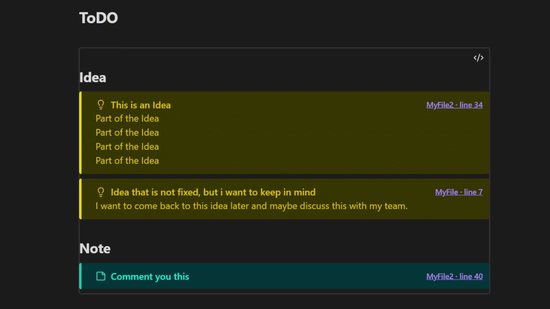
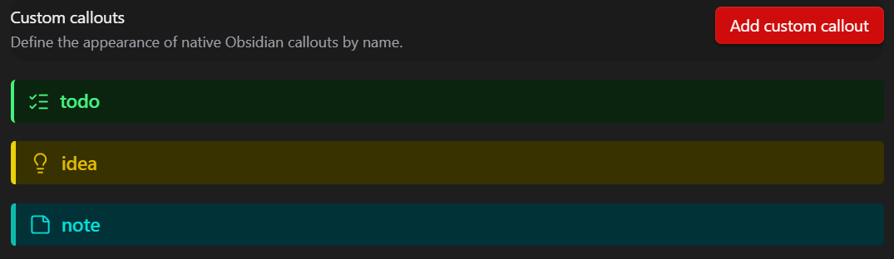
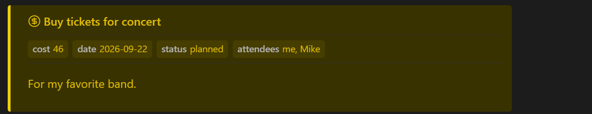

# Callout Tracker

Callout Tracker helps you stay organized in a large vault by collecting important callouts into one clickable overview.

Instead of interrupting your writing to maintain a separate task list or idea document, leave callouts where they naturally belong in your notes. Mark a thought as an `idea`, a task as a `todo`, or a useful suggestion as a custom callout such as `note` or `warning`. Callout Tracker then lets you review those items together, find what still needs to be done, revisit suggestions from your notes, and develop ideas that need more attention.

The overview is grouped by callout type, searchable, and linked back to the source note where each callout appears. This makes it easier to turn scattered thoughts across your vault into an organized workflow. It works locally in your vault and does not use network services.



## Basic usage

Write callouts where the ideas, tasks, or notes naturally belong:

```markdown
> [!idea] A useful thought
> More details here.

> [!todo] Finish the draft
```

To insert a callout at the editor cursor, run **Callout Tracker: Insert callout** from the Command Palette. Choose a callout type or enter a custom one. The command remembers the last input.

Set properties, add a checkbox, or choose whether the callout is collapsible. Save the fields as a template to quickly create similar callouts later.

Add a `callout-tracker` block to a note to create a clickable overview:

````markdown
```callout-tracker
callouts: todo, idea, note
rootfolder: MyRootFolder
```
````

This example tracks `todo`, `idea`, and `note` callouts in the `MyRootFolder` folder.

## Interactive checkboxes and collapsible callouts

Add `[ ]` or `[x]` after the callout type to make a checkbox appear in the tracker. Clicking it updates the original Markdown callout. `[x]` and `[X]` are treated as checked.

```markdown
> [!todo] [ ] Finish preparing the dungeon
> [!todo] [x] Prepare the dungeon
```

Obsidian's `+` and `-` callout markers are supported: `+` starts expanded and `-` starts collapsed. In tracker results, select the header to toggle the body; select the file and line link to open the source.

```markdown
> [!todo]+ Open by default
> This text starts visible.

> [!todo]- Closed by default
> This text starts hidden.
```

## Custom callout styles

In **Settings → Callout Tracker**, add custom callout types and define their font color, background color, optional left border, and optional icon. A live preview shows how each style looks. Styles apply to normal Obsidian callouts and tracker results.



## Callout properties

Properties attach structured values directly to a callout. Put `key:: value` rows below the header. Property names cannot contain spaces, and the property section ends at the first line that is not a property. A blank quote line is optional.

```markdown
> [!cost] Buy tickets for concert
> cost:: 46
> date:: 2026-09-22
> status:: planned
> attendees:: me, Mike
>
> For my favorite band.
```

Callout Tracker styles properties in both the original rendered callout and tracker results. Properties can also be used in filters and summaries.



## Advanced Parameters

<details>
<summary><h3 style="display: inline;">search:</h3></summary>

This optional search is case-insensitive and shows only callouts whose title, properties, or body contain the search text.

````markdown
```callout-tracker
callouts: todo, idea
search: tavern
```
````

</details>

<details>
<summary><h3 style="display: inline;">filter:</h3></summary>

The optional global `filter:` limits which callouts are displayed. It also limits the callouts available to summaries. It supports property values, numbers, strings, arithmetic, and comparisons.

For example, this global filter displays only callouts whose average `cost` and `fee` is at least 25:

````markdown
```callout-tracker
callouts: cost
filter: ({cost} + {fee}) / 2 >= 25
```
````

Supported comparison operators are `=`, `!=`, `<`, `>`, `<=`, and `>=`. Use `&` for AND, `|` for OR, parentheses to group conditions, and `!` to negate a function or parenthesized condition. Missing or non-numeric values make arithmetic comparisons fail.

Filter functions:

- `exists({property})` matches callouts that contain the property.
- `empty({property})` matches an existing property with no value.
- `missingOrEmpty({property})` matches a missing property or one with no value.
- `contains({property}, "text")` matches a property containing text, case-insensitively.
- `startsWith({property}, "text")` matches a property starting with text, case-insensitively.
- `in({property}, value1, value2, ...)` matches exact string or number values.

Checkbox keywords are `checked` and `hasCheckbox`.

````markdown
```callout-tracker
callouts: hook
filter: contains({tags}, "dragon") & in({status}, "planned", "active")
```
````

The global filter and `search:` determine which callouts are displayed.

### Named filters

Define a named filter with `filter name:` to let summaries calculate over a subset without changing which callouts are displayed. Pass the filter name as an argument to an aggregate function:

````markdown
```callout-tracker
callouts: cost
filter paris: {city} = "Paris"
filter berlin: {city} = "Berlin"
summary: "Paris total: " + sum({cost}, paris) + "€"
summary: "Berlin total: " + sum({cost}, berlin) + "€"
```
````

</details>

<details>
<summary><h3 style="display: inline;">summary:</h3></summary>

Use `summary:` to show a calculated value above the callouts. Summaries run over the results selected by `search:` and the global `filter:`. You can add multiple `summary:` lines; each becomes its own row.

````markdown
```callout-tracker
callouts: cost
summary: "Total: " + sum({cost}) + "€"
summary: "Average: " + avg({cost}) + "€"
summary: "Items: " + count()
```
````

Supported functions:

- `count()` counts every matching callout.
- `count(namedFilter)` counts callouts matching a named filter.
- `count({property})` counts matching callouts that contain the property.
- `sum(expression)` adds numeric values.
- `avg(expression)` calculates the average of numeric values.
- `max(expression)` returns the largest numeric value.
- `min(expression)` returns the smallest numeric value.
- `median({property})` returns the middle numeric value, averaging the two middle values when needed.
- `range({property})` returns the largest numeric value minus the smallest.

Numeric arithmetic works inside aggregate functions, for example `sum({cost} / 2 + 4.5)`. Missing or non-numeric values are ignored; if no numeric values remain, numeric functions return `0`. Aggregates can use a named filter, for example `sum({cost}, paris)`. Named filters only affect summaries, not the displayed callouts.

</details>

<details>
<summary><h3 style="display: inline;">display:</h3></summary>

Choose which parts of the block to show. It defaults to `All`; the other options are `OnlySummary` and `OnlyCallouts`.

````markdown
```callout-tracker
callouts: cost
display: OnlySummary
summary: "Total: " + sum({cost}) + "€"
```
````

</details>

<details>
<summary><h3 style="display: inline;">orderBy:</h3></summary>

`orderBy:` sorts callouts within each callout type, or within each group. Use one property or the title with `asc()` or `desc()`:

````markdown
```callout-tracker
callouts: todo
orderBy: asc({priority})
```
````

Numbers sort numerically and text alphabetically. Missing or empty values appear at the end. Only one `orderBy` expression is supported. Use `asc(title)` or `desc(title)` to sort by callout title.

</details>

<details>
<summary><h3 style="display: inline;">groupBy:</h3></summary>

Create collapsible sections based on a property. Without a direction, groups stay in first-seen order. Wrap the property in `asc()` or `desc()` to sort groups:

````markdown
```callout-tracker
callouts: todo
groupBy: asc({status})
orderBy: asc({priority})
```
````

`orderBy:` sorts entries inside each group. Summaries ignore groups and calculate over all matching callouts. Callouts with a missing or empty group value appear in a final `No value` group.

</details>

<details>
<summary><h3 style="display: inline;">collapse:</h3></summary>

Choose the initial state of callout results. `Default` preserves each source callout’s behavior (`+` starts expanded, `-` starts collapsed, and unmarked callouts stay unchanged). `Collapsed` or `Expanded` makes all tracker results collapsible and sets their initial state. This changes only the tracker display, not the source callouts.

````markdown
```callout-tracker
callouts: todo, idea
collapse: Collapsed
```
````

</details>

<hr>

<details>
<summary><h2 style="display: inline;">API for AI agents and integrations</h2></summary>

Callout Tracker exposes a local API on the loaded plugin instance. `search()` returns JSON-friendly results with the callout type, title, text, and file path. Markdown results also include a 1-based line number.

For Claudian or similar tools, you can use the [Callout Tracking skill](callout-tracking-skill/SKILL.md) to guide the agent in working with your vault and this API.

```ts
const tracker = Object.values(app.plugins.plugins)
    .find((plugin) => plugin?.api?.search);

await tracker.api.search({
    callouts: ['hook', 'clue'],
    search: 'dragon',
    filter: 'exists({status}) & {status} = "planned"',
});
```

The `callouts`, `search`, and `orderBy` options are optional. If omitted, the API uses the configured default root folder and default callout types `idea`, `note`, and `todo`. `filter` supports the same expressions as a tracker block. `orderBy` accepts one `asc(title)`, `desc(title)`, `asc({property})`, or `desc({property})` expression; missing and empty values are returned last.

Use `summarize()` for a calculated result with the matching callouts:

```ts
const summary = await tracker.api.summarize({
    callouts: ['cost'],
    filter: 'exists({status}) & {status} = "planned"',
    namedFilters: {
        paris: '{city} = "Paris"',
        germany: '{country} = "Germany"',
    },
    summary: '"Total: " + sum({cost}, paris) + "€"',
});

// summary.value contains the calculated text.
// summary.callouts contains the matching callouts.
```
</details>
